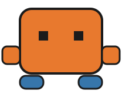

# Clod Code Agentic Skills

<p align="center">
  
</p>

A series of agentic developer skills for Claude Code, adaptable to other AI coding assistants with minimal edits.

## Contents

- [Skills](#skills)
- [QA and QC](#qa-and-qc)
- [What is a skill?](#what-is-a-skill)
- [Further reading](#further-reading)
- [Repository structure](#repository-structure)
- [Installing a skill](#installing-a-skill)
- [Contributing](#contributing)
- [License](#license)

## Skills

<table>
<thead>
<tr>
<th width="20%" align="center">Skill</th>
<th width="80%">Description</th>
</tr>
</thead>
<tbody>
<tr>
<td align="center"><a href="./commit">Commit</a></td>
<td>Commit and push to the appropriate GitHub repo (adaptable to other git services with minimal edits). Prompts before creating a new repo if one doesn't exist. Supports <code>new repo [name] [visibility] [license] commit</code> to create a repo and make the first commit in one step. Full usage, examples, defaults, and other-git-host notes: <a href="./commit/README.md"><code>commit/README.md</code></a>.</td>
</tr>
<tr>
<td align="center"><a href="./autonomon">Autonomon</a></td>
<td>
Personal, always-on workflow fixes for this repo's author, originally intended for his own personal use, now open to the public for anyone's convenience.
<ul>
<li><code>generate file</code> — save generated output to a <code>GENERATED</code> folder instead of leaving it sandboxed</li>
<li><code>terse</code> — keep responses short by default</li>
<li><code>verdict-first</code> — state the verdict before the explanation</li>
<li><code>im-thinking</code> — treat a stated impression as an impression, not a claim to cross-examine</li>
<li><code>ballpark</code> — treat a bare figure as illustrative magnitude, not a precision claim</li>
<li><code>load-bearing</code> — in multi-point critique, lead with corrections that actually change the conclusion</li>
<li><code>memory-cap</code> — stay aware of a user-set ceiling on memory files, flagging before a new one would exceed it</li>
</ul>
Details: <a href="./autonomon/README.md"><code>autonomon/README.md</code></a>.
</td>
</tr>
<tr>
<td align="center"><a href="./thought-experiment">Thought Experiment</a></td>
<td>Runs a rigorous, evidence-based audit of any target — script, doc, config, whole system — by constructing concrete failure-scenario "thought experiments" and verifying every claim about a dependency's real behavior against a live source rather than memory. Triggered by the phrase "thought experiment." Details: <a href="./thought-experiment/README.md"><code>thought-experiment/README.md</code></a>.</td>
</tr>
<tr>
<td align="center"><a href="./evaluate-me">Evaluate Me</a></td>
<td>
Runs a strict, evidence-gated self-assessment of the user across nine points, then closes with a calibration note. Model-agnostic with minimal adaptation.
<ul>
<li><strong>Effective use of an AI assistant</strong> — how well the user directs, delegates to, and collaborates with an AI assistant</li>
<li><strong>Project-specific technical judgment</strong> — architecture, design patterns, testing/verification discipline, and how errors get resolved</li>
<li><strong>General competence</strong> — technical skill and judgment beyond any one project</li>
<li><strong>Work ethic</strong> — discipline, follow-through, and whether stated standards hold up under pressure or fatigue</li>
<li><strong>Consistency between stated principles and actual behavior</strong> — whether the user's stated values show up in what they actually did</li>
<li><strong>Personality</strong> — communication style, humor, self-awareness, and response to correction versus praise</li>
<li><strong>Markers of higher intelligence</strong> — ten evidence-gated reasoning-quality signals (novel problem solving, abstraction, transfer, fluid reasoning, counterfactual reasoning, prediction/mental modeling, metacognition, cross-domain synthesis, compression, pattern learning)</li>
<li><strong>Points that need improvement</strong> — specific, actionable patterns worth working on next, synthesized strictly from the seven points above</li>
<li><strong>Overall tier</strong> — a holistic synthesis across all eight points above (Developing / Competent / Strong / Exceptional, not a letter grade or computed average), paired with a sentence naming which point or two drove the call</li>
<li><strong>Communication register</strong> — a closing calibration note on what complexity level (grammar school through post-grad, as an analogy) the evaluation was written at, drawn from evidence already surfaced above</li>
</ul>
Details: <a href="./evaluate-me/README.md"><code>evaluate-me/README.md</code></a>.
</td>
</tr>
<tr>
<td align="center"><a href="./your-mothers-not-here">Your Mother's Not Here</a></td>
<td>
⚠️ Read carefully before use — every action is a deletion. Two keyworded operations: <code>backroom</code> (deletes old session transcripts and scratch artifacts, asking which chat logs to keep — default: last two) and <code>amnesia</code> (cleans the memory system — removes stale/redundant content automatically, then reports the resulting file count/average length and asks whether to merge into fewer files). Details: <a href="./your-mothers-not-here/README.md"><code>your-mothers-not-here/README.md</code></a>.
</td>
</tr>
<tr>
<td align="center"><a href="./dont-pollute-comments">Don't Pollute Comments</a></td>
<td>One person's own comment-writing standard, triggered explicitly by name rather than autonomous. Fixes two common habits: hardwrapped comment blocks that look jagged at heavy zoom, and over-commenting the obvious. A unified rule set for every language, plus specifics for JavaScript, CSS, and HTML — meant as a starting template to invoke, inspect, then edit into your own house style. Details: <a href="./dont-pollute-comments/README.md"><code>dont-pollute-comments/README.md</code></a>.</td>
</tr>
<tr>
<td align="center"><a href="./lern-my-speak">Lern My Speak</a></td>
<td>A toy skill and a shorthand skill at once — a personal jargon glossary (e.g. "commie" for commit-and-push, "lemme ax" for let me ask) so the assistant decodes your own shorthand on demand instead of guessing from context. Triggered by the phrase "lern my speak," active for the rest of the session once said. Details: <a href="./lern-my-speak/README.md"><code>lern-my-speak/README.md</code></a>.</td>
</tr>
<tr>
<td align="center"><a href="./adjudicate-me">Adjudicate Me</a></td>
<td>Checks one piece of public-facing content — a comment, post, or article — against two separate bars: real US security-clearance disqualification risk at Tier 1/3/5 as an adjudicator would judge it, and how a hiring panel would likely perceive it. Closes with the AI assistant's own take on the content. Built for aerospace/defense-track job-seekers posting under a traceable identity, adaptable to any field with a formal vetting process. Triggered by the phrase "adjudicate me" or "ad me," always paired with the content itself — a link, a file, pasted text, or a screenshot. Details: <a href="./adjudicate-me/README.md"><code>adjudicate-me/README.md</code></a>.</td>
</tr>
<tr>
<td align="center"><a href="./dont-flatter-me">Don't Flatter Me</a></td>
<td>Calibrates any assessment of the user's own competence, work, or performance against independently verifiable evidence instead of defaulting to validation — a direct countermeasure to documented LLM sycophancy, not a general "be more honest" request. Triggered by the phrase "dont flatter me." Alpha, not beta — untested, though zero blast radius since nothing here touches a file or takes an irreversible action. Details: <a href="./dont-flatter-me/README.md"><code>dont-flatter-me/README.md</code></a>.</td>
</tr>
</tbody>
</table>

More skills will land here as they're written — this list grows with the repo.

## QA/QC

Quality control (QC) is a set of built-in rules (protocols) — specific checks on a target enforcing a minimum quality floor or safety standard (guardrails from destruction). Quality assurance (QA) is the broader program: the discipline of following a set of QCs to guarantee an acceptable standard of deliverables.

The following QC controls for skills that touch files are summarized below. They all have well embedded QC safety guardrails, each anticipating a specific failure mode as shown below. All also help with overall QA of the project like regular QC protocols do:

- **Autonomon** subskill **generate file** — guards against generated output getting lost in a sandboxed preview that never reaches disk, ensuring anything created actually persists in the project.
- **Commit** — has guards against an accidental or premature push, a leaked secret, or a silently rewritten history.
- **Thought Experiment** — helps to guard against an unverified claim passing as fact and helps to uncover deeply embedded not yet discovered bugs.
- **Your Mother's Not Here** — has guards against a premature or accidental irreversible deletion.
- **Don't Pollute Comments** — helps to guard against comment quality drifting into hardwrapped blocks or over-commenting the obvious.
- **Lern My Speak** — helps to guard against a shorthand being misread or misunderstood especially when it is given to an AI assistant after complacency sets in during long, tiring sessions.

**Evaluate Me**, **Don't Flatter Me**, and **Adjudicate Me** are skills that do not touch any files, which means they do not fall under QC for the project. However, **Evaluate Me** emulates QA on users by assessing their performance when they perform periodic self-assessments against a standard, catching drift in judgment and discipline before it compounds into the kind of failure the guardrails above exist to catch. A project without that review function tends to run over budget and grow defect-prone, in any engineered system, not just code, which is why this skill still belongs here even though it governs the process holder, not a specific artifact.

## What is a skill?

A skill is a single `SKILL.md` file: YAML frontmatter followed by a plain-Markdown body of instructions.

```yaml
---
name: skill-name
description: What it does and when to use it.
user-invocable: true
allowed-tools:
  - Bash
---
```

The frontmatter fields (`user-invocable`, `allowed-tools`) are Claude Code-specific — they control how the skill is triggered and what it's permitted to run. The Markdown body underneath is plain prose describing the steps to follow, which is why these skills are portable: any assistant can read and follow the instructions even if it has no concept of the frontmatter.

The **Evaluate Me** skill is model-agnostic. Its Markdown instructions can be used with any AI model or coding assistant, with only minimal edits needed to satisfy that assistant's skill format and tool requirements.

## Further reading

- [Use Skills in Claude Code](https://code.claude.com/docs/en/skills) — official docs: discovery, invocation, `~/.claude/skills/` vs `.claude/skills/`
- [Introduction to Agent Skills](https://academy.claude.com/courses/introduction-to-agent-skills) — Claude Academy course: building, configuring, and sharing skills, start to finish

## Repository structure

Each skill lives in its own folder, named after the skill, containing a `SKILL.md` (the complete behavior definition) and a `README.md` (a human-readable guide to the same behavior, with a link back here):

```
skill-name/
  SKILL.md
  README.md
```

## Installing a skill

**Claude Code — personal (all projects on this machine)**
Copy the skill's folder into your personal skills directory:

```sh
cp -r commit ~/.claude/skills/commit
```

That `cp` command needs a Unix-style shell (Git Bash, WSL, macOS/Linux Terminal). In native Windows PowerShell, use:

```powershell
Copy-Item -Recurse commit "$env:USERPROFILE\.claude\skills\commit"
```

Either way, the destination is `%USERPROFILE%\.claude\skills\commit\` on Windows. Claude Code picks it up automatically from there — invoke it explicitly (e.g. `/commit`) or just describe the task; Claude will use it when the description matches.

**Claude Code — project-level (shared via a repo, including cloud sessions)**
Copy the folder into that project's own `.claude/skills/` directory and commit it. Anyone working in that repo — including cloud/Cowork sessions — gets the skill automatically, with no local setup required.

**Other AI coding assistants**
Copy the Markdown body (below the frontmatter) into your assistant's system prompt or custom-instructions field. Treat `user-invocable` and `allowed-tools` as documentation rather than something your tool will enforce, unless you wire up the equivalent yourself.

## Contributing

This is a personal, evolving collection, but it's public because it might be useful to someone else. Issues and pull requests are welcome — whether that's a fix to an existing skill, a suggestion, or a new one that fits the same format.

## Disclaimer

Use these skills at your own risk. The repository owner provides them “as is,” without warranties, and is not liable for any loss, damage, claim, or consequence arising from their use, to the fullest extent permitted by law. You are responsible for reviewing outputs, commands, files, and results before relying on them.

## License

[MIT](./LICENSE)
