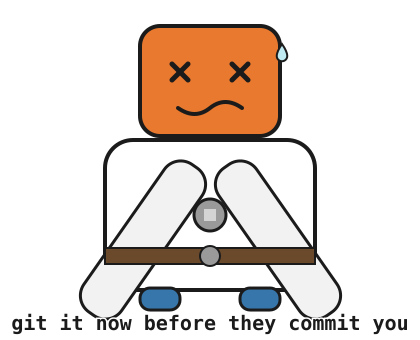

# Commit (ver 0.7.0 beta)

**Caution:** a rare missed push has occurred across real use. Mitigated by the closing verdict below — Failed, Commit, or Commit and push to [repo] — making a miss exceedingly unlikely to occur unnoticed.

**Commit and Push** — [← back to Clod Code Agentic Skills](../README.md)

When you explicitly ask for a commit, this skill commits and pushes to the already-configured remote of an existing repo, using only plain git commands — `status`, `diff`, `log`, `add`, `commit`, `push`, nothing GitHub-specific. Only tested here against GitHub, but a reasonable template to adapt for other git hosts. See [`SKILL.md`](./SKILL.md) for the complete behavior definition.

## What to expect

Every way this skill can be invoked, and what happens for each:

| You type | What happens |
| --- | --- |
| `commit` — repo exists | Reviews the repository, stages only relevant files, checks for secrets and stray files, drafts the message (subject and body both), creates the commit, and pushes it — setting up tracking with `-u` if there's no upstream yet. Nothing to commit, or a rejected push, is reported instead of being forced through. |
| `commit` — repo exists, no remote | You are asked for an existing remote URL to attach. |
| `commit` — no repo here | Cannot be executed — no git repository exists here, and this skill doesn't create one. |
| Anything missing or ambiguous | You are asked to clarify rather than having it guessed. |

Nothing is staged, committed, or pushed merely because a good moment is noticed. You must explicitly say `commit` before those actions occur.

Saying `commit` pushes too, as one combined action — you don't need to ask for the push separately. Say `just commit` or `don't push` instead if you want the commit made without pushing it.

Every run closes with one verdict: **Failed** (reason given), **Commit** (not pushed), or **Commit and push to [repo]**.

### Defaults

The only values supplied automatically when you leave them out. Ambiguous or missing values outside this list prompt a question:

| Value | Assumed if not given |
| --- | --- |
| Remote name | `origin` |
| Branch to push | whichever branch is currently checked out (never switched on your behalf) |

## Related skills

- [Thought Experiment](../thought-experiment) — grew out of an early audit of this skill.

## Disclaimer

Use these skills at your own risk. The repository owner provides them “as is,” without warranties, and is not liable for any loss, damage, claim, or consequence arising from their use, to the fullest extent permitted by law. You are responsible for reviewing outputs, commands, files, and results before relying on them.

---
[← back to Clod Code Agentic Skills](../README.md)
