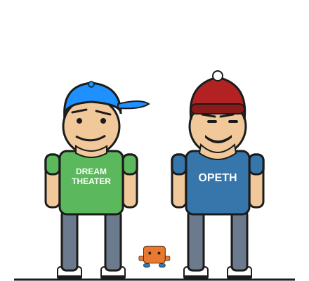

# Lern My Speak (ver 1.0.0 beta)

  

**A toy skill and a shorthand skill, at once** — [← back to Clod Code Agentic Skills](../README.md)

One person's own personal jargon, defined once so an assistant stops guessing at it from context and just reads it correctly instead. The complete operating definition is in [`SKILL.md`](./SKILL.md).

## Toy skill and shorthand skill, at once

This is comical to read — a glossary of someone's own casual typing shorthand looks funny laid out as a formal table. It's also a genuinely small, real utility: a long session develops its own vocabulary, and re-explaining or re-inferring the same handful of words every time is friction worth removing. There's a second kind of friction this happens to help with too: QWERTY layouts make certain words — "probably" is a common one — more typo-prone for an unskilled typist, and a short, clearly-defined stand-in like "prolly" sidesteps that risk entirely. Both labels are accurate at once; neither cancels the other out.

## How it works

Say the phrase "lern my speak" — wrapped in whatever sentence feels natural, or on its own — and it's active for the rest of the session. No need to repeat it on every message afterward.

Once active, every term in the glossary gets read as its listed meaning, not guessed at or asked about.

## Make it your own

The glossary in [`SKILL.md`](./SKILL.md) is one person's real shorthand, kept short specifically so it's easy to hand-edit. Add, remove, or redefine entries to match your own. There's no live "define X as Y" mechanism mid-session — growing the list means opening the file and adding a line, the same way every other skill in this repo gets maintained.

**One warning, not a guardrail:** don't map a term to another installed skill's trigger phrase, or to a destructive action. This skill has no technical check against that collision — avoiding it is on whoever edits the list.

## Related skills

- [Autonomon](../autonomon) — the other skill here that shapes ongoing behavior rather than a one-shot action, in the opposite direction: autonomon is always-on with no keyword at all and shapes the assistant's own output, this one needs one explicit trigger per session and shapes how your input gets read.

## Disclaimer

Use these skills at your own risk. The repository owner provides them "as is," without warranties, and is not liable for any loss, damage, claim, or consequence arising from their use, to the fullest extent permitted by law. You are responsible for reviewing outputs, commands, files, and results before relying on them.

---
[← back to Clod Code Agentic Skills](../README.md)
