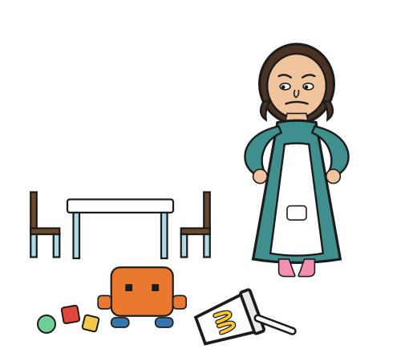

  

# Your Mother's Not Here (ver 1.0.5 beta)

# ⚠️ Read carefully before use — every action is a deletion

**Claude-Generated Backroom File Cleanup** — [← back to Clod Code Agentic Skills](../README.md)

Two keyworded operations: **backroom** (old session transcripts, sandbox-style scratch, Playwright/screenshot artifacts) and **amnesia** (stale/redundant memory cleanup + consolidation). The specifics below reflect one person's workflow, not a universal standard. Backroom defaults to keeping the last two chat logs. Amnesia's own calls — what counts as "stale" memory content, whether merging those memory files is worth it — are left as judgment, not given a default. Read [`SKILL.md`](./SKILL.md) in full and edit it to match your own situation before trusting it with anything you can't afford to lose.

## Where this came from

This came out of an actual cleanup pass on a long-running project: 40+ small memory files consolidated into 3 type-organized ones, superseded component drafts cleared from a `GENERATED/` folder after confirming by content (not filename) that they were dead, and old session transcripts deleted down to a user-chosen set. Each step started with a listing and a question before anything irreversible happened — this skill generalizes that rhythm into two named operations.

## What backroom and amnesia do

- **`backroom`** — files. Always lists available chat logs and asks *which to keep* before touching any transcript — never skipped, though it defaults to the last two if you don't specify otherwise. Standard artifacts (Playwright output, caches, shell snapshots) clear without ceremony; sandbox-style drafts (`tmp/`, `scratch/`, or similar) only get deleted when literally named `temp`/`old`/`draft` and superseded by a current file — and even then, only after their content is actually checked to confirm it's dead, not just their filename. A folder literally named `GENERATED/` is never touched at all — deletion rights there belong to the user alone, same standing as `memory/`.
- **`amnesia`** — memory. Never runs unprompted; needs the keyword named explicitly, or an explicit yes after backroom offers it. Removes stale content and redundancies automatically once triggered (both verified against the current codebase, not assumed from age), then reports the resulting file count and average length, then asks a plain yes/no on merging the rest into fewer type-organized files — asked after the safe cleanup, with real numbers, not blind upfront.

Run both in one call — e.g. *"your mothers not here do amnesia too"* — or either alone.

## Using it

Invoke by name for `backroom`; name `amnesia` explicitly to include memory cleanup, or say yes when `backroom` offers it. Expect a non-destructive listing first, the relevant question before anything is touched or merged, content checks on anything ambiguous, a two-lens report (prune? what's lost?) at moderate detail, and a clear accounting of what was actually removed once it acts.

## Disclaimer

Use these skills at your own risk. The repository owner provides them "as is," without warranties, and is not liable for any loss, damage, claim, or consequence arising from their use, to the fullest extent permitted by law. You are responsible for reviewing outputs, commands, files, and results before relying on them.

---
[← back to Clod Code Agentic Skills](../README.md)
